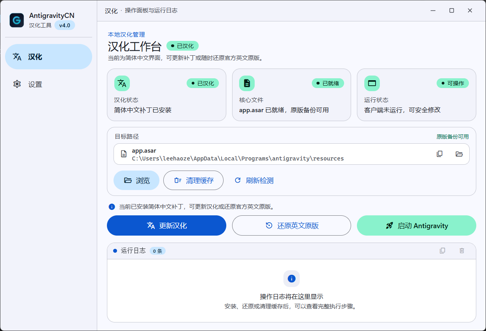

# AntigravityCN

Google Antigravity 桌面客户端的简体中文汉化工具。提供 Windows 单文件便携版与图形化工作台，无需安装额外运行环境，开箱即用。

<p align="left">
  
  
  
  
  
  
  
</p>



## 功能特点

- **现代化汉化工作台**：基于 Material Design 3 设计，采用无边框标题栏与 Windows Mica 材质，支持浅色、深色和跟随系统三种主题。
- **状态一眼掌握**：首页集中显示汉化状态、`app.asar` 核心文件、原版备份与客户端运行状态，并在操作后自动刷新。
- **一键安装与随时还原**：首次汉化自动备份官方原版为 `app.asar.backup`；已汉化时按钮自动切换为“更新汉化”，也可随时还原英文原版。
- **完整的路径工具**：支持自动检测常见安装位置、手动浏览 `app.asar`、复制完整路径、在文件资源管理器中定位文件，以及重新检测状态。
- **进程冲突保护**：检测到 Antigravity 正在运行时，会在安装或还原前弹出确认框，可一键关闭客户端并继续操作，避免文件被占用。
- **缓存清理与快捷启动**：内置临时缓存清理功能，解决客户端更新或汉化后界面残留旧文案的问题，并支持直接启动 Antigravity。
- **可视化运行日志**：安装、还原、清理缓存等操作会输出带时间戳的分类日志，支持一键复制全部日志或清空记录。
- **防干扰内容保护**：动态翻译界面时自动跳过代码编辑器、终端容器、输入框、斜杠命令及 AI 思考过程（Thinking）正文，避免污染代码与模型推理内容。
- **单文件绿色版**：可执行程序内置汉化补丁与静态资源，正式使用无需额外安装 Node.js、Python 等依赖。

## 界面与操作

左侧导航包含 **汉化** 与 **设置** 两个页面：

- **汉化工作台**：顶部展示汉化、核心文件与运行状态卡片；中部可浏览并管理 `app.asar` 路径；底部提供“安装汉化 / 更新汉化”“还原英文原版”“启动 Antigravity”三个主要操作，以及运行日志面板。
- **设置**：可在外观主题中切换跟随系统、浅色模式或深色模式；帮助与关于区域展示自动备份、无损还原机制及项目仓库入口。

## 使用方法

### 图形界面（推荐）

1. 下载或编译生成 `AntigravityCN.exe`，直接双击运行。
2. 程序会自动检测 Antigravity 的常见安装位置；如未找到，点击 **【浏览】** 选择 `resources\app.asar`。
3. 确认状态卡片中的核心文件已就绪，点击 **【安装汉化】**。
4. 若 Antigravity 正在运行，在弹出的提示框中点击 **【关闭程序并继续】**，等待汉化完成。
5. 点击 **【启动 Antigravity】** 即可体验简体中文界面。
6. 如需恢复官方英文原版，点击 **【还原英文原版】**。

> 提示：汉化后若界面文案未刷新，可点击 **【清理缓存】** 后重新启动客户端。路径区域还支持复制完整路径和打开所在文件夹。

### 命令行模式

程序支持命令行参数，便于编写脚本或自动化调用：

```powershell
# 一键安装汉化（自动查找安装路径）
.\AntigravityCN.exe -apply

# 还原官方英文原版
.\AntigravityCN.exe -restore

# 清理客户端临时渲染与编译缓存
.\AntigravityCN.exe -clean-cache

# 启动客户端
.\AntigravityCN.exe -launch

# 查看全部命令行参数
.\AntigravityCN.exe -help
```

常用参数说明：

| 参数 | 说明 |
| :--- | :--- |
| `-apply` | 执行简体中文汉化注入 |
| `-restore` | 从备份还原官方英文原版 |
| `-clean-cache` | 清理客户端临时缓存（不影响用户配置与登录状态） |
| `-launch` | 启动 Antigravity 客户端 |
| `-path <路径>` | 手动指定 `app.asar` 文件的绝对路径 |
| `-force-close` | 若检测到 Antigravity 正在运行，自动关闭进程以释放文件占用 |
| `-help` | 显示命令行参数帮助信息 |

示例：指定路径安装并在程序运行时自动关闭：

```powershell
.\AntigravityCN.exe -apply -force-close -path "D:\Tools\Antigravity\resources\app.asar"
```

## 词典维护

汉化词典存放在 `patches/locales/zh-CN/` 目录下，按功能模块化维护：

- `通用.json`：全局基础操作、按钮、系统菜单、命令面板与常用提示。
- `设置.json`：外观偏好、安全预设、终端沙箱、模型与配额限额等。
- `对话.json`：聊天会话、代码审查 Diff、任务状态提示等。
- `工作区.json`：项目管理、Git 相关功能、扩展系统（Skills、Rules 等）及 MCP 服务。

程序在汉化注入时会自动合并该目录下的所有 JSON 词典。如需补充翻译，直接在对应 JSON 文件中添加键值对即可。

`scripts/` 目录下提供了辅助维护脚本：

- `audit_locales.js`：检查词典冲突与格式变体。
- `prune_locales.js`：对照当前版本 UI 前端包审计并删除未使用词条（`--write` 写回）。
- `locale_allowlist.json`：登记服务端下发或运行时拼接、无法在前端包中直接检索到的词条。

## 源码构建

如需自行编译二进制文件，请参考以下步骤：

### 环境要求

- Windows 10/11
- [Go](https://go.dev/) 1.22 及以上
- [Node.js](https://nodejs.org/) 18+ 与 npm
- [Wails CLI v2](https://wails.io/)（安装命令：`go install github.com/wailsapp/wails/v2/cmd/wails@latest`）

### 构建步骤

在项目根目录下运行打包脚本：

```powershell
# 使用 PowerShell 构建（推荐）
.\build.ps1

# 或使用批处理脚本
.\build.bat
```

构建成功后，可执行文件位于 `build/bin/AntigravityCN.exe`。

## 项目结构

```text
├─ frontend/              Vue 3 + TypeScript 工作台界面
│  └─ src/
│     ├─ components/     通用、仪表盘与设置组件
│     ├─ composables/     汉化流程、主题、日志与通知逻辑
│     └─ views/           汉化工作台与设置页
├─ internal/
│  ├─ asar/               ASAR 解包与封装
│  └─ patcher/            路径检测、备份还原与补丁注入
├─ patches/               汉化注入脚本与模块化词典
├─ scripts/               构建与词典维护脚本
└─ docs/                  README 界面预览资源
```

## 常见问题

- **客户端更新后汉化失效？**
  客户端自动更新会覆盖 `app.asar`。只需重新运行本工具并点击 **【安装汉化 / 更新汉化】**（或执行 `.\AntigravityCN.exe -apply`）即可重新应用。
- **提示文件被占用导致汉化失败？**
  在界面提示中点击 **【关闭程序并继续】**；命令行模式下可添加 `-force-close` 参数让程序自动结束相关进程。
- **汉化后部分界面仍显示英文？**
  可能是 Chromium 视图缓存未更新，点击界面上的 **【清理缓存】**（或执行 `.\AntigravityCN.exe -clean-cache`）后重新启动客户端即可。
- **如何确认当前是否已汉化？**
  查看工作台顶部的“汉化状态”卡片，或观察主按钮显示为“安装汉化”还是“更新汉化”。

## 说明与协议

- 本项目基于 MIT 协议开源，仅供个人学习与交流使用。
- 项目中涉及的 Google Antigravity 软件著作权及商标归 Google 及其关联公司所有。
